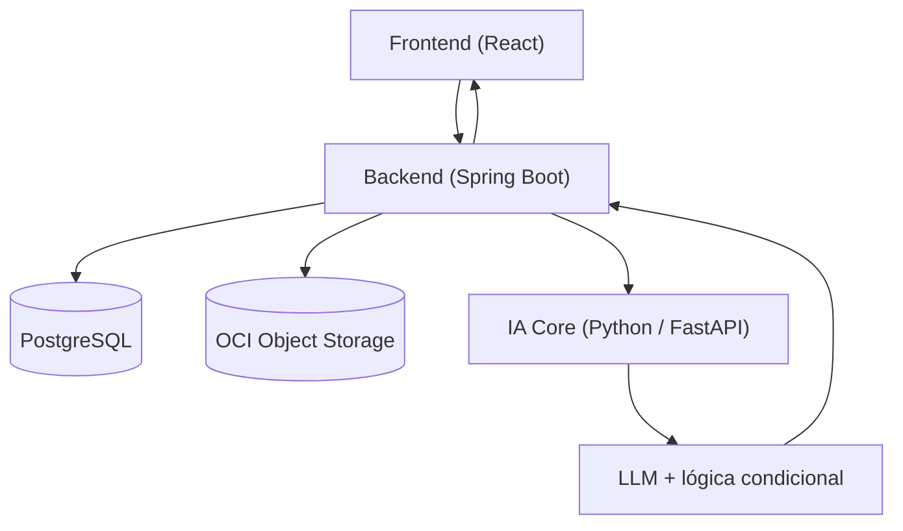
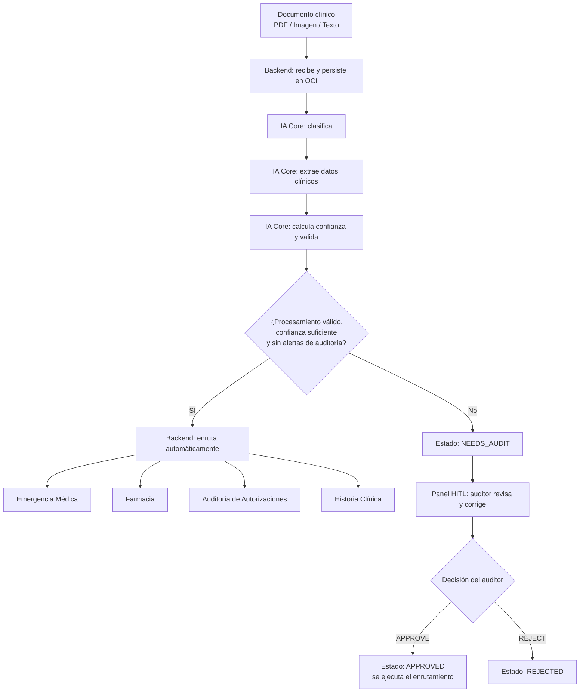

<div align="center">
  <h1>
    
    
  </h1>

  <p>Agente para triaje, extracción y enrutamiento de documentos clínicos con revisión humana.</p>

  <p>
    
    
    
    
    <br>
    
    
    
    
  </p>

  <p><strong>Programa ONE · Grupo 10 — Oracle Next Education &amp; Alura</strong></p>

  <p><strong><a href="https://mediflowia.dev/">Sitio web oficial del MVP</a></strong></p>
  <p>Demostración pública para uso exclusivo con datos sintéticos.</p>
</div>

> Documentación técnica completa de arquitectura y contratos: [`docs/ARCHITECTURE.md`](./docs/ARCHITECTURE.md) — *v1.0, Baseline approved*.

> Demostración local con persistencia y revisión humana: [`docs/local-demo.md`](./docs/local-demo.md).

---

## Guía rápida para evaluación

- [Problema y objetivo del MVP](#el-problema)
- [Funcionalidades reales](#funcionalidades-del-mvp)
- [Arquitectura y flujo](#arquitectura-resumida)
- [Estructura del repositorio](#estructura-del-repositorio)
- [Ejecución local](#cómo-ejecutar)
- [Escenarios obligatorios](#los-3-escenarios-obligatorios-de-demostración)
- [Datos de prueba y evidencias](#datos-de-prueba-y-evidencias)
- [Limitaciones](#limitaciones-del-mvp)
- [Documentación](#documentación-del-proyecto)

## El problema

Hospitales, laboratorios y aseguradoras de salud pierden miles de horas con equipos administrativos leyendo manualmente informes y recetas para transcribir datos en sistemas heredados. Ese proceso manual es lento, costoso y está sujeto a errores graves de tipeo y demoras en la atención de pacientes con cuadros de urgencia.

**MediFlow** es un agente autónomo que recibe documentos clínicos y administrativos (PDF, imagen o texto), los clasifica, extrae sus datos esenciales con LLMs, evalúa consistencia y confianza, y los enruta automáticamente al destino correcto — con revisión humana (Human-in-the-Loop) para los casos ambiguos o de baja confianza.

## Objetivo del MVP

1. **Ingerir** documentos clínicos en PDF, imagen o texto/JSON.
2. **Clasificar** automáticamente el tipo de documento (receta, informe de imágenes, informe de estudio, orden de procedimiento, epicrisis, certificado médico).
3. **Extraer** datos clínicos y administrativos esenciales (paciente, profesional/matrícula, diagnóstico/CIE-10, medicamentos, dosis, urgencia).
4. **Evaluar** consistencia, conflictos y confianza de la extracción.
5. **Enrutar** el resultado hacia el destino correspondiente (Emergencia Médica, Farmacia, Auditoría de Autorizaciones, Historia Clínica, o Revisión Humana en caso de ambigüedad).

## Funcionalidades del MVP

- Ingestión de PDF, JPG, PNG y texto mediante el Backend.
- Clasificación, extracción estructurada, validación y confianza mediante IA Core y Gemini.
- Extracción de `lab_results` para documentos `STUDY_REPORT`, conservada dentro de `extracted_data`.
- Persistencia del original y del resultado actual en OCI Object Storage, y del estado consultable e historial en PostgreSQL.
- Visualización estructurada de datos generales y resultados de laboratorio.
- Flujo Human-in-the-Loop para revisar, corregir, aprobar o rechazar documentos.
- Recuperación del resultado actual y de los snapshots confirmados del historial.
- Centro de ayuda en `/help`, con guías para archivo y texto, estados, problemas frecuentes y preguntas frecuentes.
- Enrutamiento lógico/simulado y notificación de urgencias; no se invocan sistemas hospitalarios externos.

La presencia de una función en el código no sustituye su validación operativa. Los resultados de ejecución se consideran comprobados únicamente cuando existe evidencia registrada.

## Arquitectura resumida



- **Frontend** envía el documento (archivo o texto) al Backend y consume el resultado o el panel de auditoría.
- **Backend** persiste en OCI y PostgreSQL, normaliza la entrada, llama al servicio de IA, valida su respuesta y arma la respuesta final.
- **IA Core** clasifica, extrae, calcula confianza, valida y sugiere el destino de enrutamiento.
- El procesamiento es **síncrono** para el MVP: sin colas, con timeout de 30 segundos por intento y como máximo 1 retry ante fallos transitorios de IA (hasta 60 segundos de espera de IA, más persistencia y transporte).

El enrutamiento del MVP es **lógico/simulado**: persiste el destino, lo expone en el resultado JSON y en el Frontend, y refleja el estado en OCI; no integra sistemas hospitalarios externos. PostgreSQL conserva el resultado actual y un historial de resultados/decisiones disponible en `GET /api/v1/documents/{id}/history`. OCI conserva el original y un artefacto JSON del resultado y la decisión actuales.

El detalle completo de contratos entre componentes, estados, `audit_reasons`, modelo de datos y manejo de errores está en [`docs/ARCHITECTURE.md`](./docs/ARCHITECTURE.md). Los campos adicionales de `extracted_data`, incluido `lab_results`, viajan dentro de la respuesta canónica: Backend los persiste y reconstruye, y Frontend los presenta y permite revisarlos sin crear contratos o endpoints paralelos.

## Diagrama del flujo del agente



## Tecnologías

| Componente | Stack |
|---|---|
| Frontend | React, TypeScript, Vite, Material UI, React Router |
| Backend & Cloud | Java, Spring Boot, PostgreSQL, Docker, OCI SDK |
| IA & Lógica Core | Python, FastAPI, Pydantic, LangGraph (o pipeline Python puro) |
| LLM | Google Gemini API |
| Persistencia de archivos | OCI Object Storage (capa Always Free) |

## Estructura del repositorio

```text
backend/    # API, orquestación y persistencia
frontend/   # interfaz web y revisión humana
ai-core/    # clasificación y extracción con IA
docs/       # arquitectura, guías y documentación técnica
test-data/  # casos y datos sintéticos del MVP
```

Las reglas de organización y contribución se detallan en [`CONTRIBUTING.md`](./CONTRIBUTING.md).

## Documentación por componente

La documentación del proyecto se organiza por ámbito de responsabilidad:

- **Arquitectura y contratos compartidos:** [`docs/architecture/`](./docs/architecture/)
- **Frontend & UX:** [`docs/frontend-ux/`](./docs/frontend-ux/)
- **Backend & Cloud:** [`docs/backend-cloud/`](./docs/backend-cloud/)
- **IA Core:** [`docs/ia-core/`](./docs/ia-core/)
- **Producto & QA:** [`docs/producto-qa/`](./docs/producto-qa/)
- **Backend:** [`backend/README.md`](./backend/README.md)
- **Frontend:** [`frontend/README.md`](./frontend/README.md)
- **IA Core:** [`ai-core/README.md`](./ai-core/README.md)

La referencia canónica de arquitectura y contratos compartidos continúa siendo [`docs/ARCHITECTURE.md`](./docs/ARCHITECTURE.md).

---
## Cómo ejecutar

### Opción recomendada: demostración local

La guía [`docs/local-demo.md`](./docs/local-demo.md) inicia un entorno aislado con PostgreSQL y almacenamiento local, e incluye un smoke test persistente. Permite verificar procesamiento, consulta, revisión humana e historial sin credenciales de OCI. No sustituye la validación de Gemini ni del despliegue OCI.

### Requisitos generales

- Git.
- Docker y Docker Compose para PostgreSQL y el entorno integrado.
- Java 21 para Backend nativo.
- Python 3.12 para IA Core nativo.
- Node.js compatible con Vite 8.3.0 para Frontend nativo.

### Clonar el repositorio

```bash
git clone https://github.com/No-Country-simulation/G10-MediFlow-Team11.git
cd G10-MediFlow-Team11
```

### Base de datos PostgreSQL

MediFlow utiliza PostgreSQL como motor de persistencia. En el entorno de desarrollo, el servicio se ejecuta mediante Docker Compose con almacenamiento persistente y verificación de disponibilidad.

#### Configuración

Desde la raíz del repositorio, crea el archivo local de variables de entorno:

```bash
cp .env.example .env
```

En Windows PowerShell:

```powershell
Copy-Item .env.example .env
```

Define un valor seguro para `DB_PASSWORD` en `.env` antes de iniciar el servicio.

#### Iniciar PostgreSQL

```bash
docker compose up -d postgres
```

Verifica el estado:

```bash
docker compose ps
```

PostgreSQL estará disponible cuando el servicio aparezca con estado `healthy`.

Para detener los servicios conservando los datos:

```bash
docker compose down
```

La configuración detallada del entorno, persistencia, resolución de conflictos de puerto y conexión con el Backend se encuentra en [`docs/backend-cloud/postgresql-docker.md`](./docs/backend-cloud/postgresql-docker.md).

### Servicios

```bash
# Backend (Spring Boot) — requiere PostgreSQL en ejecución y las variables de .env
# disponibles en la sesión (ver la guía de PostgreSQL)
cd backend
./mvnw spring-boot:run

# IA Core (Python)
cd ../ia-core
pip install -r requirements.txt
uvicorn app.main:app --reload

# Frontend (React + Vite)
cd ../frontend
npm install
npm run dev
```

### Variables de entorno

PostgreSQL y la conexión del Backend utilizan las variables definidas en la plantilla [`.env.example`](./.env.example), en la raíz del repositorio. El archivo `.env` es local, no se versiona y debe definir `DB_PASSWORD`:

```env
DB_HOST=localhost
DB_PORT=5432
DB_NAME=mediflow
DB_USER=mediflow_user
DB_PASSWORD=
```

Variables de referencia para la integración con OCI e IA Core:

```env
OCI_BUCKET_NAME=mediflow-documentos-clinicos
OCI_NAMESPACE=<namespace>
MEDIFLOW_AI_SERVICE_URL=http://localhost:8000
AUDIT_CONFIDENCE_THRESHOLD=0.85
GEMINI_API_KEY=<api-key>
GEMINI_MODEL=<model-id>
```

Compose usa el `.env` para interpolar `compose.yaml`; solo las variables declaradas en `environment` se entregan a cada contenedor. El Backend contenerizado recibe `MEDIFLOW_AI_SERVICE_URL=http://ai-core:8000`, `DB_HOST=postgres` y `DB_PORT=5432`, independientemente de los valores locales de la plantilla. Spring Boot ejecutado fuera de Docker requiere las variables en el entorno de su proceso.

### Despliegue en OCI Compute (Issue #59)

La [guía de despliegue](./docs/backend-cloud/oci-compute-deployment.md) reutiliza el único `compose.yaml` sobre `MediFlow_Core_VM`: configuración protegida, ARM64, Instance Principals, HTTPS y verificaciones. El MVP está publicado; los registros de despliegue y las evidencias de los equipos conservan el alcance de cada comprobación.

## Los 3 escenarios obligatorios de demostración

| # | Escenario | Resultado esperado |
|---|---|---|
| 1 | Flujo estándar procesado automáticamente | `status = PROCESSED`, ruteo automático sin auditoría |
| 2 | Caso con prioridad de urgencia médica | `classification.priority_level = URGENT`, `routing_decision.primary_destination = MEDICAL_EMERGENCY`, notificación generada |
| 3 | Caso ambiguo / erróneo → revisión humana | `status = NEEDS_AUDIT` con al menos un motivo en `audit_reasons` (ej. `LOW_CONFIDENCE`, `ILLEGIBLE_DOCUMENT`), corregido vía panel HITL |

Los criterios completos se mantienen en [escenarios y criterios de aceptación](./docs/producto-qa/MediFlow_Escenarios_Prueba_Criterios_Aceptacion_MVP_v1.0.md).

## Datos de prueba y evidencias

- [Datos de prueba y escenarios del MVP](./docs/MediFlow_Datos_Prueba_Escenarios_MVP_v1.1.md): cobertura sintética y resultados esperados. La validación estática no equivale a una ejecución PASS.
- [`test-data/`](./test-data/): fixtures sintéticos para los escenarios funcionales y técnicos.
- [Evidencias de OCI Compute](./docs/backend-cloud/oci-compute-deployment-evidence.md): verificaciones registradas y pendientes explícitos del despliegue.

No se declaran como PASS las ejecuciones que carecen de evidencia. Las funciones presentes en el código integrado se distinguen de su validación operativa.

## OCI Object Storage

Bucket único `mediflow-documentos-clinicos` (capa Always Free), organizado por prefijos lógicos:

```
recibidos/              (archivos y textos crudos apenas llegan)
procesados/urgentes/    (urgentes procesados correctamente o aprobados por humano)
procesados/rutina/      (rutina procesados correctamente o aprobados por humano)
auditoria_humana/       (pendientes de revisión humana o rechazados)
```

## Limitaciones del MVP

- Procesamiento síncrono; no incluye colas, workers ni polling.
- Enrutamiento lógico/simulado, sin integraciones hospitalarias externas.
- Datos exclusivamente sintéticos; autenticación, autorización granular y cumplimiento regulatorio de producción quedan fuera de alcance.
- Base64 es aceptable únicamente para el volumen acotado del Hackathon.
- Sin resiliencia distribuida avanzada ni historial técnico exhaustivo de cada transición interna.
- La presencia de rutas, reglas y pruebas unitarias en el código integrado no acredita por sí sola una ejecución end-to-end con Gemini, OCI y PostgreSQL; esa validación operativa permanece `NOT_VERIFIED` cuando no existe evidencia de ejecución.

## Documentación del proyecto

- [Arquitectura y contratos canónicos](./docs/ARCHITECTURE.md)
- [Demostración local](./docs/local-demo.md)
- [Backend y Cloud](./docs/backend-cloud/README.md)
- [Producto y QA](./docs/producto-qa/README.md)
- [Guía de contribución](./CONTRIBUTING.md)

---

Para contratos de API, modelo de datos, máquina de estados, `audit_reasons`, manejo de errores y responsabilidades por squad, ver la documentación técnica completa: [`docs/ARCHITECTURE.md`](./docs/ARCHITECTURE.md).
